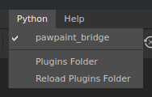
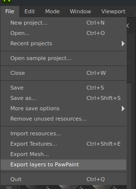
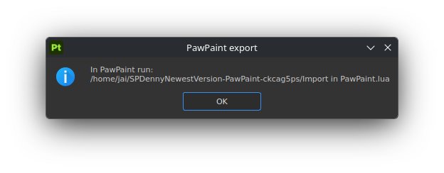
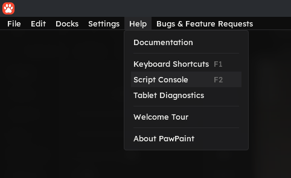
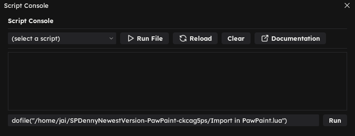
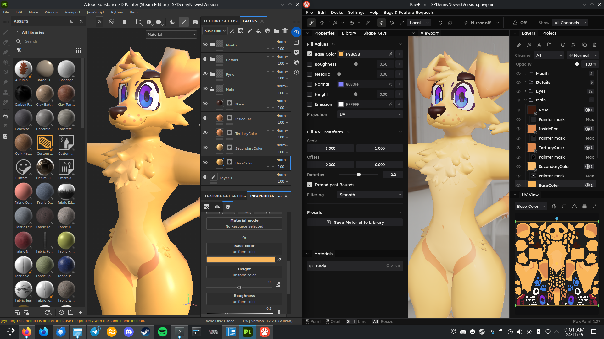

# SPP2PP - Substance Painter to PawPaint Converter

## Actual readme coming eventually.

Horrible human-made code I clobbered together after I had one of those headaches with pictures (ideas) that it should be possible.

Basically expects the project to be *specifically* one of Kokou's avatars because that's all I've tested at the moment.

Doesn't do any kind of normals or anything yet, haven't tested if PP (lol) supports them in the same way.

All it does is take the base colour of a paint layer and mask, exports the mask to an image, and copies the colour to a json file.

You'll need an actual copy of substance still, unfortunately I don't see a way this can be done without it because some of this will rely on SPP's "engine".

Intended to be used by avi authors that want to provide the option for their avi's to be textured somewhere else because PP is a single-payment and not exortion priced like SP or a subscription.

## How to use - WIP

Half-assed guide, will probably change once I add roughness and normals and shit. 

Clone or download this repo, and copy `pawpaint_bridge.py` into the following locations:

- Linux: ~/Documents/Adobe/Adobe Substance 3D Painter/python/plugins/
- Mac: ~/Library/Application Support/Adobe/Adobe Substance 3D Painter/plugins/
- Windows: %AppData%\Adobe\Adobe Substance 3D Painter\plugins\

(note: haven't checked if windows or mac are correct, I just copied them off [this guide](https://howtoguidehq.com/how-to-substance-painter-how-to-install-plugins/))

Relaunch Substance painter and you should see under the "Python" dropdown that `pawpaint_bride` appears like this:



Open your project and then go to file -> "Export layers to PawPaint" should appear:



When you click export, it will create a folder in the same directory as the spp file you opened plus some random letters on the end so it doesn't accidentally overwrite an older export.

> [!IMPORTANT]
> Make a note of the location, you will need it later!



Next, in PawPaint, before opening a project go to Help -> Script Console or press F2:



In the PawPaint dialogue, type in `dofile("")` and point it to the .lua script that substance created and click "Run" on the right.

```lua
dofile("{LOCATION OF THE EXPORT}/Import in PawPaint.lua")
```



If all goes well you should see your Substance Painter project loaded into PawPaint.


